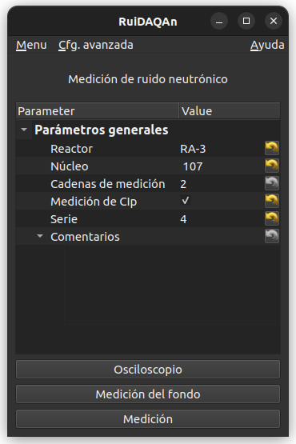
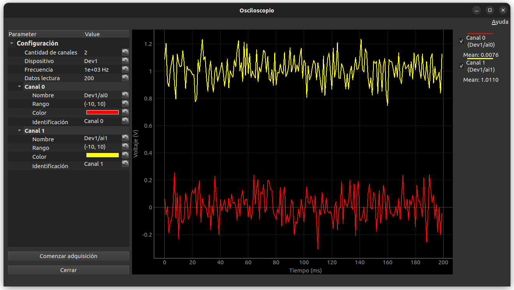
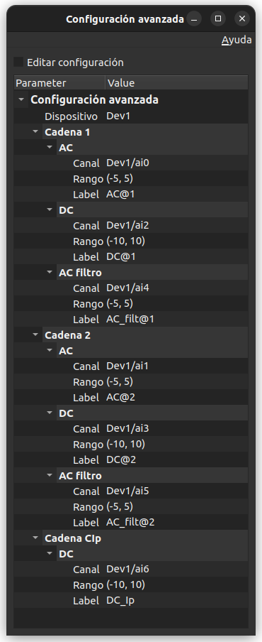
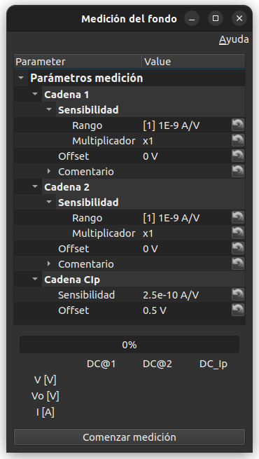
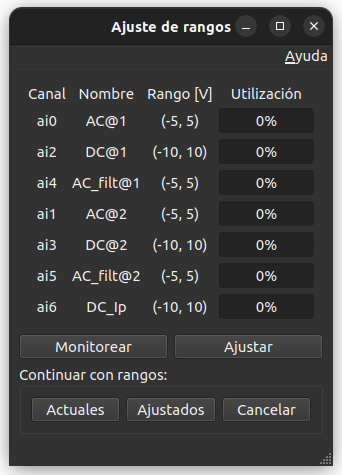
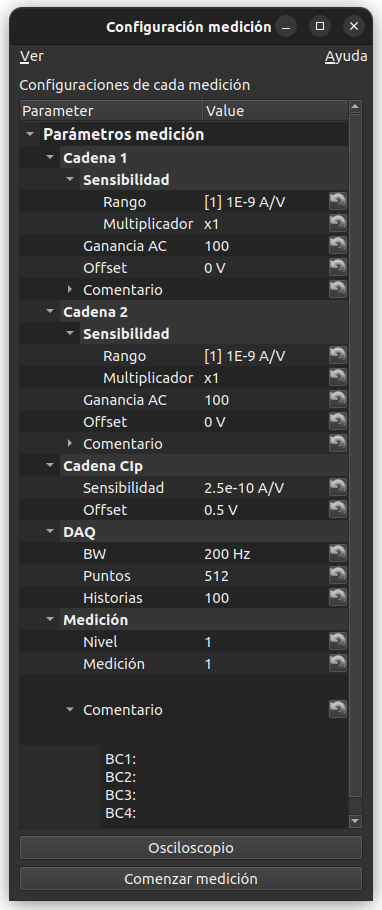
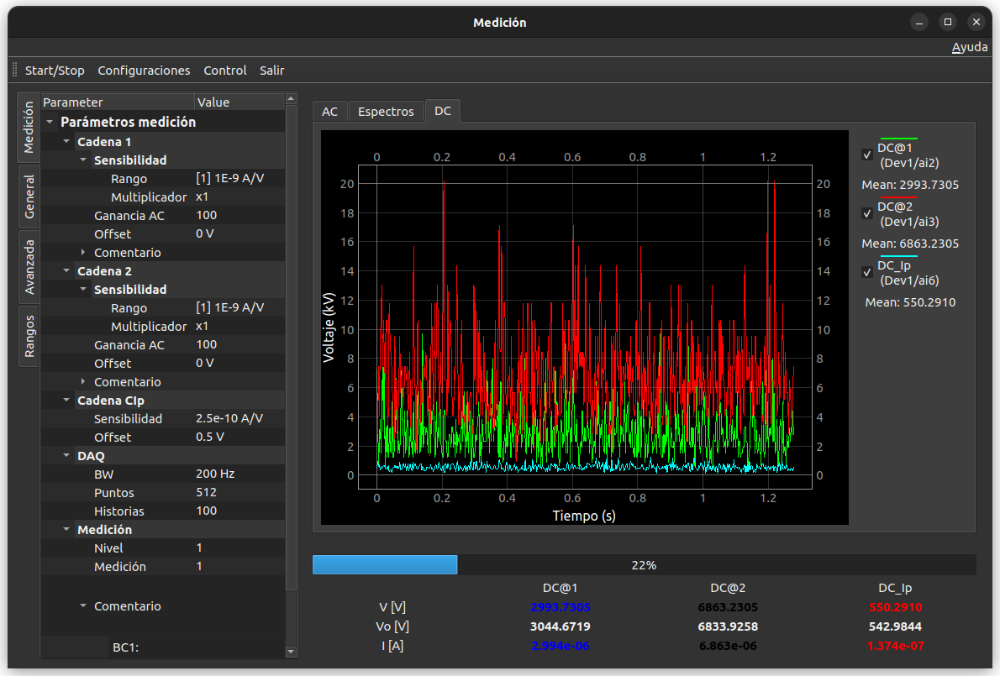
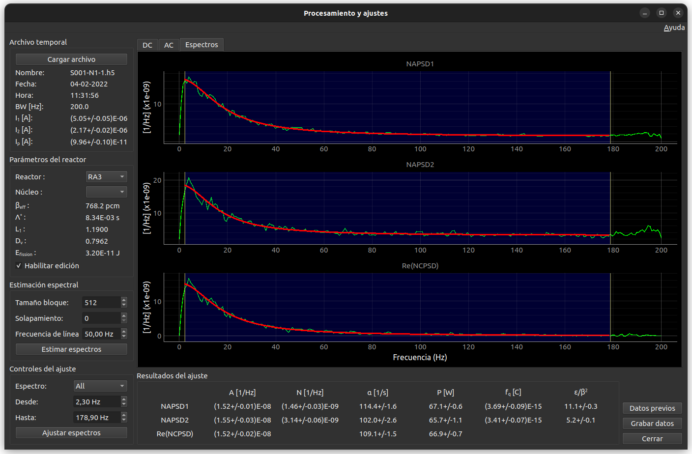

Ventanas
========

Se describen los contenidos y comportamientos de las principales ventanas que 
posee el programa.

Está orientado para ayudar al usuario a entender todos los parámetros 
relevantes para la adquisición y procesamiento de señales durante una 
calibración en potencia.

Ventana principal
-----------------


Es la ventana principal para la adquisición de datos. Se abre al ejecutar, 
desde la línea de comandos, cualquiera de los dos comandos:

.. code-block:: bash
   
   > ruidaqan adquisicion
   > ruidaqan a

En esta ventana se definen los parámetros generales de las mediciones. Los 
valores aquí definidos serán comunes para todas las mediciones realizadas 
durante una calibración en potencia.



Parámetros configurables
++++++++++++++++++++++++

**Reactor**
    Nombre del reactor en donde se realiza la medición. En base a este nombre
    se elegirán las constantes nucleares como así también las funciones
    transferencia para normalizar los espectros.

**Núcleo**
    Identificación del núcleo en donde se realizal a medición.  Junto con
    **Reactor** se utilizará para elegir las constantes nucleares.

**Cadenas de medición**
    Cantidad de cadenas neutrónicas utilizadas para la medición. La cantidad 
    mínima es 1. La cantidad máxima está limitada por cuántas señales se 
    pueden adquirir (por cada cadena se adquieren tres señales).

**Medición de CIp**
    Indica si se utilizará la placa de adquisición para medir la señal de Ip 
    (tildado) o por el contrario, se utilizará el ingreso manual de datos 
    (no tildado).

**Serie**
    Identificación de la medición. Se utilizará, entre otras cosas, para 
    identificar los nombres de los archivos de datos guardados.

**Comentarios**
    Cualquier tipo de comentario relevante para la medición.


Botones y menú
++++++++++++++

**Osciloscopio**
    Abre la pantalla del osciloscopio.

**Medición de fondo**
    Abre la pantala para la medición de fondo.

**Medición**
    Abre la pantalla para la medición de ruido neutrónico

**Menú**
    TODO

**Cfg. Avanzada**
    Permite abrir la ventana de configuración avanzada

**Ayuda**
    Ayuda e información del programa


Osciloscopio
------------

Aplicación para visualizar las señales conectadas en las distintos canales
analógicos de la placa de adquisición.



La adquisición se realiza en forma de bloques, cuya cantidad de puntos se puede
configurar.

Se pueden configurar tanto los parámetros comunes a todos los canales, como así
también parámetros individuales a cada canal por separado.

**Parámetros comunes**
    Configuran la forma en que se realizará la adquisición de datos

    - Cantidad de canales: cantidad de canales que se desean adquirir.

    - Dispositivo: identificación del dispositivo NI dispinible para la
      adquisición. Sólo se muestran los disponibles.

    - Frecuencia: frecuencia de muestreo, en Hertz.

    - Datos lectura: Cantidad de puntos que se desean adquirir en cada bloque.


**Parámetros de cada canal**
    Configuran los parámetros de cada canal por separado.

    - Nombre: identificación del canal analógico. Sólo se muestran los
      disponibles en la placa de adquisición.

    - Rango: rango en que se realizará la adquisicón. Sólo se muestran los 
      rangos disponibles en la placa de adquisición.

    - Color: color que tendrán los datos adquiridos al ser visualizados.

    - Identificación: nombre con que se identificarán a la curva de datos
      adquiridos al ser graficados.

En la parte derecha del gráfico se pueden seleccionar, mientras se realiza la 
adquisición, qué canales visualizar. Para ello se debe tildar o des-tildar la
identificación correspondiente a cada canal.

Configuración avanzada
----------------------

En esta ventana se permite hacer una configuración detallada de la tarjeta
que se utilizará para la adquisición de datos y de sus parámetros asociados.




*Importante:*
    *Esta ventana se debe acceder una vez seteados los parámetros de la `Ventana
    principal`_ (pues depende de ellos).*

Al abrir esta ventana, por default lo hace en modo de sólo lectura. Si se desea
modificar los parámetros abrá que tildar, en la parte superior, la opción
**Editar configuracón**

Los parámetros configurables están organizados en tres grupos: dispositivo,
cadenas para la medición de ruido neutrónico y cadena para la medición de Ip (
en caso de haber tildado **Medición de CIp** en la `Ventana principal`_).

**Dispositivo**
    Selección del dispositivo NI con que se hará la adquisición de datos.
    Automaticamente se listan todos los dipositivos disponibles. Pueden ser
    reales o simulados.

**Cadena n**
    En cada cadena se deben especificar la adquisicón de las tres señales: 

    - AC: Canal donde se hará la adquisición de la componente fluctuante a
      la salida del filtro anti-aliasing.

    - DC: Canal donde se hará la adquisición de la componente contínua a la
      salida del amplificador.

    - AC filtro: Canal donde se hará la adquisición de la componente
      fluctuante que entra al filtro anti-aliasing (salida del
      amplificador).

    En cada una de ellas se podrán configurar los siguientes parámetros:

    - **Canal**
        Nombre del canal de la tarjeta de adquisición donde se leerá la señal.
    
    - **Rango**
        Rango de la tarjeta con que se medirá la señal.
    
    - **Label**
        Identificación que se le dará a la señal adquirida (es lo que 
        aparecerá en los gráficos).
      
    
**Cadena CIp**
    Aparece sólo si se tildó **Medición de CIp** en la `Ventana principal`_.
    Sólamente se configura la adquisición de la señal de DC de dicho detector.
    Los parámetros son similares a los especificados anteriormente para cada
    **Cadena n**.

La lista de canales disponibles, como así también de rangos disponibles, son
leídos directamente del **Dispositivo** indicado.

Por default, el orden en que se especifican los canales coincide con el orden 
utilizado por el programa FERCIN-3 para la adquisición de dos cadenas de ruido.

Conviente siempre adquirir canales consecutivos. De nos ser posible, se deben
corto-circuitear los canales libres intermedios.


Medición de fondo
------------------

Esta ventana permite fijar los parámetros para realizar la medición de fondo.




Los parámetros a configurar están agrupados por cadena de medición. 


**Cadena n**
    Los parámetros configurables asumen que se está trabajando con un 
    amplificador CNEA-K330, aunque existe la opción de introducir los valores
    de forma personalizada para cualquier otro tipo de amplificador.

    - **Rango**
        Rango del amplificador que relaciona la corriente medida
        (en Amperes) con el voltaje adquirido (en Volts). Se listan los rangos
        disponibles del amplificador CNEA-K330.

    - **Multiplicador**
        Multiplicador del rango. La sensibilidad (S) del amplificador se tomará
        como: `S = multiplicador x rango`. Se listan los multiplicadores
        disponibles del amplificador CNEA-K330.

    En caso de seleccionar la opción **Otro** en el rango en lugar de
    **Multiplicador** aparecerá **Manual** y se podrá escribir directamente la
    sensibilidad del amplificador utilizado en unidades de A/V.

    - **Offset**
        Cero-vivo (en Volts) del amplificador utilizado. Para el
        CNEA-K330 es cero.

    - **Comentario**
        Para introducir cualquier información relevante sobre la medición de
        fondo.

**Cadena CIp**
    Sólo aparece en caso de haber tildado **Medición de CIp** en la `Ventana
    principal`_.

    - **Sensibilidad**
        Sensibilidad del amplificador de CIp utilizada para convertir la
        corriente medida en voltaje, en unidades de A/V.

    - **Offset**
        Cero-vivo (en Volts) del amplificador utilizado para la cadena CIp


Una vez finalizada la configuración, se debe apretar el botón **Comenzar
medición** ubicado en la parte inferior de la pantalla. Al hacerlo, se abrirá
la ventana de `Ajuste de rangos`_.

Al comenzar la medición de fondo se podrá ver el avance a través de la barra
de progreso. 

Se muestran también los voltajes (en Volts) instantáneos de cada señal medida.
Los instantáneos (promedio de cada bloque adquirido) y el inicial. Utilizando
la sensibilidad y el offset definidos se muestra también la corriente (en
Amperes).

Los valores instantáneos cambian de color cuando éstos cambian en más de un 1%
respecto al valor inicial (ver clase `ProgresoMedicion` en `procesado_gui.py`):

- negro: valores dentro del 1% respecto al valor inicial
- rojo: valores en más del 1% por encima del valor inicial
- azul: valores en más del 1% por debajo del valor inicial

La comparación entre valores instantáneos e iniciales se hace sobre las
corrientes medidas (y no sobre los voltajes).

La medición de fondo se hace tomando 512 puntos con una frecuencia de muestreo
de 400 Hz. Se toman 100 bloques (o historias) en total (ver 
clase `BackgroundWindow` en `acquisition_window.py`).

**Control de saturación**
    No se comprueba la saturación de entrada del filtro anti-aliasing.
   
    Tampoco que las señales AC estén en el rango correcto (ya que no 
    intervienen en la medición de fondo). Sólo se comprueba la saturación de 
    rango en las señales DC.

**Archivos generados**
    Los valores de las corrientes de fondo son guardados en el archivo
    `SXXX-FONDOS` (donde XXX es la **Serie** definida en la `Ventana 
    principal`_). Todas las corrientes con sus incertezas se ordenan por fila 
    (ver encabezado de dicho archivo).

    Por compatibilidad con el programa FERCIN3, también se guardan en los 
    archivos `FONDO1`, `FONDO2` (en caso de medir con dos detectores) y 
    `FONDO-IP` por separado.


Ajuste de rangos
----------------

Esta ventana permitirá ajustar de forma óptima a los rangos utilizados para la
adquisición de voltaje de la tarjeta.





Una vez abierta esta ventana, automáticamente se comenzará a buscar cuál es el
mejor rango para utilizar con cada canal.

En la parte superior de la pantalla se muestran cuatro columnas que contienen
al canal, su identificación (el **Label** puesto en `Configuración avanzada`_),
el rango y el porcentaje de utilización de dicho rango.

**Monitorear**
    Calcula el porcentaje de utilización de los rangos actuales de la tarjeta 
    (por lo general serán aquellos configurados en `Configuración avanzada`_).

**Ajustar**
    Selecciona a los mejores rangos disponibles en la tarjeta de acuerdo a las
    señales medidas en cada canal.

Si los porcentajes de utilización de los rangos no son satisfactorios, se debe
cerrar esta ventana, para volver a la anterior y modificar los parámetros del
amplificador.

Si los porcentajes de utilización de los rangos son satisfactorios, se puede
continuar con alguna de las tres opciones:

**Actuales**
    Comienza la medición utilizando los rangos actuales de la tarjeta. Esta 
    opción permite trabajar con rangos fijos (aquellos fijados en
    `Configuración avanzada`_).

**Ajustados**
    Comienza la medición utilizando los rangos ajustados de acuerdo al criterio
    (TODO).

**Cancelar**
    Cierra la ventana sin efectuar ninguna modificación en los rangos. Se
    retorna a la ventana `Medición de fondo`_ para realizar las modificaciones
    pertinentes.

Si se selecciona **Actuales** o **Ajustados** comienza la medición de fondo y 
se vuelve a la ventana `Medición de fondo`_ donde se indicará el progreso de
la misma.


Configuración de cada medición
-------------------------------

Esta ventana permite configurar los parámetros relacionados con cada medición
individual.




**Cadena n**
    Los parámetros configurables asumen que se está trabajando con un 
    amplificador CNEA-K330, aunque existe la opción de introducir los valores
    de forma personalizada para cualquier otro tipo de amplificador.

    - **Rango**
        Rango del amplificador que relaciona la corriente medida
        (en Amperes) con el voltaje adquirido (en Volts). Se listan los rangos
        disponibles del amplificador CNEA-K330.

    - **Multiplicador**
        Multiplicador del rango. La sensibilidad (S) del amplificador se tomará
        como: `S = multiplicador x rango`. Se listan los multiplicadores
        disponibles del amplificador CNEA-K330.

    En caso de seleccionar la opción **Otro** en el rango en lugar de
    **Multiplicador** aparecerá **Manual** y se podrá escribir directamente la
    sensibilidad del amplificador utilizado en unidades de A/V.

    - **Ganancia AC**
        Ganancia que se aplica a la componente fluctuante de la señal. Sólo se
        permite elegir entre las ganancias disponibles dek amplificador 
        CNEA-K330.

    - **Offset**
        Cero-vivo (en Volts) del amplificador utilizado. Para el
        CNEA-K330 es cero.

    - **Comentario**
        Para introducir cualquier información relevante sobre la medición. Está
        por compatibilidad con el FERCIN3, en el futuro será eliminado.


**Cadena CIp**
    Sólo aparece en caso de haber tildado **Medición de CIp** en la `Ventana
    principal`_.

    - **Sensibilidad**
        Sensibilidad del amplificador de CIp utilizada para convertir la
        corriente medida en voltaje, en unidades de A/V.

    - **Offset**
        Cero-vivo (en Volts) del amplificador utilizado para la cadena CIp

**DAQ**
    Configuración de parámetros relevantes para la adquisición de datos.

    - **BW**
        Ancho de banda (en Hz) que se utilizará para la medición. la frecuencia
        de muestreo será el doble de **BW**.

    - **Puntos**
        Cantidad de datos que se adquirirán por bloque (o historia).

    - **Historias**
        Cantidad de historias que se adquirirán por medición


**Medición**
    Configuración para identificar a cada medición

    - **Nivel**
        Número que identifica al nivel de potencia en que se está midiendo

    - **Medición**
        Número para identificar a la medición dentro de un mismo **Nivel**

    - **Comentario**
        Cualquier comentario relevante a la medición en particular.

        Este campo será el reemplazo de los comentarios que se hacen dentro
        de cada **Cadena n**.

En el menú superior se encuentra un botón para abrir la ventana de **Ajustes**
en caso de que se quiera analizar una medición ya realizada.

En la parte inferior se encuentran los botones para abrir el **Osciloscopio** y
para **Comenzar la medición**.

Al apretar **Comenzar la medición**, primero se abrirá la ventana de `Ajuste
de rangos`_ idéntica a la descripta anteriormente. Una vez ajustados los rangos
se abrirá la ventana de `Medición`_ y la medición comenzará automáticamente.


Medición
--------

Esta ventana muestra los datos adquiridos mientras se está efectuando la
medición. Permite también ver el progreso de la misma y comprobar los valores
más relevantes.




**Gráficos**
    Los gráficos se organizan a través de tres solapas (**AC**, **Espectros** y
    **DC**):

    - **AC**
        Muestra el gráfico con los valores de las componentes fluctuantes de
        las señales medidas. Se actualiza con cada historia leída.

    - **Espectros**
        Muestra el espectro asociado de la componente fluctuantes **AC**. Con
        cada nueva historia adquirida se calcula un espectro. El gráfico que
        se muestra consiste en los promedios de todos los espectros adquiridos 
        hasta ese momento.

        **Importante**: los espectros no están normalizados con las corrientes
        medias, como así tampoco están corregidos por la función transferencia.
        Sólo se lo pone para ir viendo si la forma del espectro es la esperada.

    - **DC**
        Muestra el gráfico con los valores de las componentes contínuas de las 
        señales medidas. Se actualiza con cada historia leída.

En todas las pestañas es posible elegir qué señales se mostrarán al tildar o no
tildar la identificación de cada señal en la columna a la derecha de los
gráficos.

En la parte inferior se muestra información sobre el progreso de la medición y
sobre los valores medios medidos. Son idénticos a los descriptos en la ventana
de `Medición de fondo`_.


Barra de menú
+++++++++++++

**Start/Stop**
    Comienza y detiene la medición. Para usar en caso de que algo salga mal, de
    lo contrario no debe accionarse (la medición comienza y termina
    automáticamente).

**Configuraciones**
    Muestra y/o oculta las pestañas de configuración, que aparecerá a la
    izquierda de los gráficos. Se muestran todas los parámetros configurados
    (en modo sólo lectura). También existe una pestaña para controlar 
    visualmente la saturación de los rangos de cada señal.

**Control**
    Abre una ventana donde se replica toda la información sobre el progreso de
    la medición (lo que aparece en la parte inferior de la ventana de 
    `Medición`_. Está ampliada para que, de ser necesario, pueda ser observada
    de lejos.

**Salir**
    Cierra la ventana de `Medición`_. Salvo que algo haya salido mal, no es 
    necesario accionar este botón. La ventana se cerrará sola una vez
    finalizada la medición.
    

Procesamiento y ajustes
-----------------------

Es la ventana que permite procesar los datos medidos y realizar los ajustes 
espectrales para obtener los parámetros cinéticos de interés.

Puede ser considerado como un programa en sí mismo, pero que está acoplado
a la ventana de adquisición. Se llega a ella mediante dos maneras: 

1. A través de la consola, escribiendo cualquiera de los siguientes comandos:

   .. code-block:: bash
       
       > ruidaqan procesamiento
       > ruidaqan p


   De esta forma habrá que abrir manualmente el archivo con los datos 
   adquiridos. La ventana funciona de forma autónoma.
   

2. Automáticamente se abrirá esta ventana al finalizar una adquisición de datos.

   En este caso, se abre el archivo corresponiente a la medición que acaba de
   finalizar.



El uso de esta ventana consiste en cuatro etapas consecutivas:

1. Cargado del archivo con los datos medidos

2. Selección de los parámetros cinéticos del reactor

3. Estimación de los espectros (NPSD y/o CPSD)

4. Ajuste de los espectros para obtener los parámetros cinéticos


Dependiendo de cómo se llame a esta ventana, es posible que muchas de estas
etapas se ejecuten automáticamente (con parámetros por default o leidos del 
archivo con los datos adquiridos).

1. Cargado del archivo
+++++++++++++++++++++++

Permite abrir el archivo que contiene los datos adquiridos. Reconoce los
siguientes archivos:

- Archivos grabados por el programa ``RuiDAQAn``

  Tanto en el formato HDF5 (extensión .h5) como con el formato similar al 
  FERCIN3 (extensión .RUI)

- Archivos grabados con el programa ``FERCIN3``

  Son archivos con extensión .RUI. La mayoría de las veces se los reconoce por
  haber sido generados a partir de una DAQ de 12 bits.

- Archivos grabados con el programa ``FERCIN3-VB```

  Son archivos con extensión .RUI. La mayoría de las veces se los reconoce por 
  haber sido generados a partir de una DAQ con 16 bits.

Como se puede ver, los archivos con formato .RUI pueden venir de distintos 
programas de adquisición. Se los diferencia por la cantidad de bits de la DAQ 
(se analizan los datos adquiridos, es confiable para identificar una DAQ de 16
bits, pero para una de 12 bits puede ser erróneo).

Tanto los programas ``RuiDAQAn`` como ``FERCIN3-VB`` trabajan con DAQ de 16 
bits. La diferencia radica en que el primero genera un archivo extra con los 
valores de los coeficientes para pasar de enteros a voltajes 
(``SXX-coeficientes_int_to_volt.pkl`` dentro de la carpeta ``datos``). 
Entonces, al cargar el .RUI, el programa busca dicho archivo. Si no lo 
encuentra, asume que fue generado por el ``FERCIN3-VB`` y se toman 
coeficientes genéricos.


2. Selección de los parámetros cinéticos del reactor
++++++++++++++++++++++++++++++++++++++++++++++++++++

Se deberá seleccionar el reactor y, de ser necesario, el núcleo en donde se 
realizaron las mediciones. Estos datos están incluidos en los archvios .h5, 
por lo cual la selección se hace automáticamente. De todas formas, si se desea
modificar esos parámetros, se debe tildar ``Habilitar edición``.

Si se abre un .RUI se debe saber de ante-mano en qué reactor se realizó la 
medición.

Los datos cinéticos son leidos del archivo 
``ruidaqan/constantes/constantes_reactores.py`` ubicado en la carpeta donde
se instaló el paquete. Si se quieren agregar o modificar datos, se deberá
editar dicho archivo (y volver a abrir el programa).


3. Estimación de los espectros
++++++++++++++++++++++++++++++

En esta parte se configuran los parámetros que definen cómo se hará la 
estimación espectral.

Se utilizará el estimador de Welch para los espectros (se dividen todos
los datos en bloques, con o sin solapamiento, se calculan espectros de
cada bloque y finalmente se promedian).

**Tamaño bloque**
    Cantidad de datos que se utilizarán para calcular cada espectro.    

**Solapamiento**
    Cantidad de datos que se solaparán entre bloques consecutivos

**Frecuencia de línea**
    Se utilizará para eliminar el pico en el espectro correspondiente a la
    frecuencia de línea y a sus dos primeros armónicos
    (:math:`f_l, 2f_l\text{ y } 3f_l`).
    La forma de eliminar el pico es buscando el punto donde ocurre y borrando
    dicho punto con sus dos vecinos.


4. Ajuste de los espectros
++++++++++++++++++++++++++

Se define el rango de frecuencias en donde se hará el ajuste.

Los valores por default coinciden con los utilizados por el programa
`FERCIN3`.

Se pueden seleccionar los espectros individualmente o todo juntos, a través
del combo-box **Espectros**. La selección también se puede hacer moviendo
la zona de ajuste desde el mismo gráfico.


Cuando se abre un archivo .h5, los pasos 1 a 4 se realizan automáticamente.

Una vez realizado el ajuste, aparecerán los resultados en la parte inferior de 
la ventanaUna vez realizado el ajuste, aparecerán los resultados en la parte 
inferior de la ventana.

Los botones a la derecha son:

**Datos previos**
    Basado en el número de serie del archivo con datos, se abrirá (de existir) 
    la ventana de `Resultados`_ con los datos de las mediciones previas de la
    misma serie. 

    Se abre el archivo ``SXXX-resultados_ajustes.pkl``.

**Grabar datos**
    Una vez que se está conforme con los resultados del ajuste, es necesario
    apretar este botón para que queden guardados.
    
    Se guarda en el archivo ``SXXX-resultados_ajustes.pkl``.

    **Importante**: Si no se aprieta este botón, no se guardan los datos.

**Cerrar**
    Cierra la ventana del programa.
